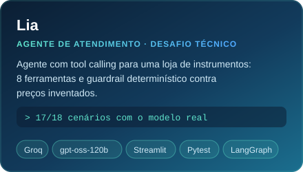
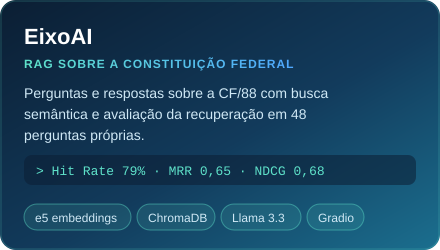
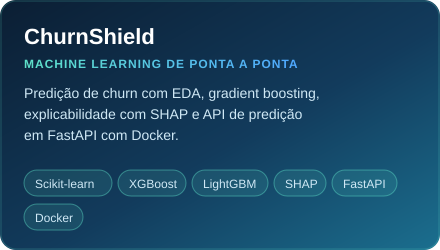
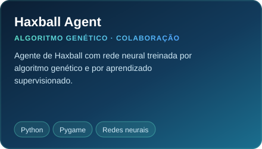
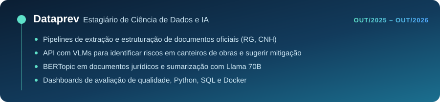
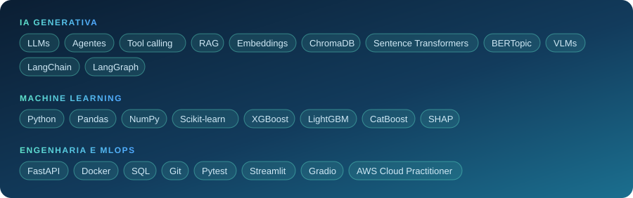

<p align="center">
  
</p>

<p align="center">
  <a href="https://www.linkedin.com/in/kaiowellinghton"></a>
  <a href="mailto:kaiowellinghton@gmail.com"></a>
  
</p>


Gosto de pegar um problema real e levar a IA até onde ela é útil de verdade: com dados, métricas e código que roda fora do notebook. Na **Dataprev**, trabalhei com LLMs e VLMs para extrair informações de documentos oficiais e apoiar decisões no setor público. Nos meus projetos, construo sistemas RAG avaliados com métricas de recuperação e agentes com tool calling e guardrails.

```python
kaio = {
    "último":     "Estagiário de Ciência de Dados e IA @ Dataprev (out/2025 a out/2026)",
    "formação":   "Ciência de Dados e IA @ UFPB (conclusão em dez/2026)",
    "foco":       ["RAG", "agentes e tool calling", "avaliação de LLMs", "MLOps"],
    "procurando": ["AI Engineer", "MLOps Engineer", "Cientista de Dados"],
    "base":       "João Pessoa, PB 🇧🇷",
    "idiomas":    {"português": "nativo", "inglês": "B2"},
}
```


<p align="center">
  <a href="https://github.com/kaio-w-b/lia-customer-service-agent"></a>
  <a href="https://github.com/kaio-w-b/EixoAi"></a>
</p>
<p align="center">
  <a href="https://github.com/kaio-w-b/ChurnShield"></a>
  <a href="https://github.com/joaopviana2004-tech/Haxball_Genetic_Agent"></a>
</p>







<br>


<p align="center">
  <a href="https://www.linkedin.com/in/kaiowellinghton"></a>
  <a href="mailto:kaiowellinghton@gmail.com"></a>
</p>
